# Embedded Library Workshop

A directory of Jonas Atelier’s robotics libraries. Start with a part number if you have a board on your desk, or a task if you’re choosing the software first.

## Library search

**Contents** · [Public libraries](#public-libraries) · [ESP32 and STM32 drivers](#esp32-and-stm32-drivers) · [Portable C libraries](#portable-c-libraries) · [ESP-IDF components](#esp-idf-components) · [Robots and build tools](#robots-and-build-tools) · [Roadmap](#roadmap)

Use **Ctrl+F** or **⌘F** on this page to find a chip such as `BMP280`, an algorithm such as `Kalman`, or a bus such as `CAN`. Linked repository names open public source. Plain-text names identify projects on the workshop bench. To search across repositories, [search Jonas Atelier READMEs on GitHub](https://github.com/search?q=user%3AJonasAtelier+in%3Areadme+CAN&type=repositories) and replace `CAN` with your search term.

## Public libraries

| Library | What you can build | Try it |
| --- | --- | --- |
| [UPID](https://github.com/JonasAtelier/upid) | A feedback loop with bounded output, filtering, and manual control. Portable C99. | [Run a heater simulation on your computer](https://github.com/JonasAtelier/upid#run-the-heater-example) |
| [esp-sn65hvd230-can](https://github.com/JonasAtelier/esp-sn65hvd230-can) | A Classic CAN node using an ESP32, ESP-IDF 5.x, and a 3.3 V transceiver. Hardware validation pending. | [Wire two nodes and receive a frame](https://github.com/JonasAtelier/esp-sn65hvd230-can#receive-your-first-frame) |

## ESP32 and STM32 drivers

Each library groups parts that do the same job. For example, the barometer drivers expose pressure and temperature through a common interface, so an application can change sensors without rewriting how it uses each reading. Platform support varies by chip and peripheral.

| Library | Task | Parts and interfaces |
| --- | --- | --- |
| `mcu-imu` | Measure acceleration and rotation | MPU-6050, ICM-45686, ICM-42688-P, BMI088, BMI270, WT901C-TTL |
| `mcu-compass` | Measure magnetic field or heading | QMC5883L, QMC5883P, IST8310, LIS3MDL, CMPS14 |
| `mcu-baro` | Measure air pressure and estimate height changes | BMP280, BMP388, DPS310, MS5611 |
| `mcu-encoder` | Measure shaft position | AS5047P, AS5600, AMT102-V |
| `mcu-loadcell` | Read a strain gauge or weighing scale | HX711, NAU7802 |
| `mcu-tof` | Measure distance to a surface | VL53L1X, TF-Luna |
| `mcu-lidar` | Read a 2D scan | LDROBOT LD19, LD06 |
| `mcu-uwb` | Measure distance between radio nodes | DW1000 ultra-wideband |
| `mcu-powermon` | Monitor voltage and current | INA219, INA226, INA228, INA237 |
| `mcu-battery` | Estimate cell charge or monitor a battery pack | MAX17048, BQ76920, BQ76930, BQ76940 |
| `mcu-stepper` | Drive a stepper motor | TMC2209 over UART, TMC5240 over SPI |
| `mcu-esc` | Command a motor controller | DJI C610, C620, GM6020, C615, Haitai HT-03, DShot |
| `mcu-servo` | Position a hobby servo | MCU PWM output or PCA9685 |
| `mcu-can` | Exchange CAN frames | MCP2515, ESP32 TWAI, STM32 bxCAN and FDCAN |
| `mcu-rc` | Decode a radio-control receiver | CRSF/ELRS, SBUS, DJI DR16 |
| `mcu-gamecontroller` | Read gamepad input | DualShock 4, DualSense, Xbox. STM32 support covers report parsing. |
| `mcu-expander` | Add digital input and output pins | MCP23017 over I²C, MCP23S17 over SPI |

## Portable C libraries

| Library | Choose it when you need to… |
| --- | --- |
| [UPID](https://github.com/JonasAtelier/upid) | Bring a measured value toward a target with proportional, integral, and derivative control. |
| `algo-filter` | Estimate a value from noisy readings. Includes Kalman, extended Kalman, complementary, Madgwick, particle, and recursive least-squares algorithms. |
| `algo-control` | Control a changing load, balance a system, or regulate motor current. Includes ADRC, LQR, impedance control, and field-oriented control. |
| `algo-kinematics` | Calculate arm position and joint torque, or estimate a wheeled robot’s motion. |
| `algo-motion` | Turn waypoints into a smooth path and track it with pure pursuit. |
| `algo-behavior` | Choose a robot’s next action using a state machine or behavior tree. |

## ESP-IDF components

| Component | Purpose |
| --- | --- |
| [esp-sn65hvd230-can](https://github.com/JonasAtelier/esp-sn65hvd230-can) | Send, receive, and filter Classic CAN frames. |
| `esp-c620-control` | Control a RoboMaster motor through a C620 controller. |
| `esp-drv8323-gatedriver` | Configure a DRV8323 three-phase gate driver. |
| `esp-ads1115-adc` | Measure analog voltages with a four-input, 16-bit converter. |
| `esp-ssd1306-oled` | Draw on an SSD1306 OLED display over I²C. |
| `esp-ws2812-led` | Drive addressable RGB LEDs with the ESP32 RMT peripheral. |
| `esp-espnow-link` | Exchange ESP-NOW packets between boards. |
| `esp-ota-wifi` | Update firmware over Wi-Fi. |
| `esp-sdlog` | Buffer measurements and write them to an SD card. |

## Robots and build tools

| Project | What the libraries do together |
| --- | --- |
| Dingo · `dingo_s3` | Raspberry Pi and ESP32-S3 versions of a quadruped controller. The S3 version still awaits robot testing. |
| `nova_s3` · `flux_s3` | Nova steers and drives a swerve wheel. Flux controls a single three-phase motor. Both are experimental. |
| `hawk` · `nexus_p` · `Hawk_control` | Flight-controller firmware, power monitoring, and ROS 2 controller input for Hawk. |
| `esp-forge` · `stm-forge` | Build firmware from a target configuration and pinned libraries for ESP32 or STM32. `rmboard_f427` is the RoboMaster Type A board bring-up app. |
| `Robust` · `nv-ps-controller` | Linux tools for exchanging messages between robot processes and reading PlayStation controllers. |

## Roadmap

| Area | Planned work |
| --- | --- |
| Sensors and peripherals | BNO085 orientation, MMC5983MA compass, AS5048A encoders, TFmini ranging, TCA9548A I²C multiplexing, and u-blox GNSS |
| Algorithms | Hampel outlier filtering and trapezoidal and S-curve motion profiles |
| Robot projects | Arachne spider robot, Navis ground vehicle, Helios humanoid, and Jarvis robotic arm |

[Jonas Atelier on GitHub](https://github.com/JonasAtelier)
