  

<h1 align="center">Embedded Library Workshop</h1>

  <strong>Find a driver. Pick a library. Build your next project.</strong>

Reusable C libraries, drivers for ESP32 and STM32, and robot projects from
Jonas Atelier. This repo is the catalog; each project keeps its code and setup
instructions in its own repository. Drivers are grouped by kind: chips that do
the same job share one Linux-IIO-style library, `mcu-<cat>`, behind a single
`struct <cat>_dev` API that builds unchanged on ESP-IDF and the STM32 HAL.

## Start here

| Want to… | Open |
|---|---|
| Control a motor, heater, or other feedback loop | [upid — portable PID controller](https://github.com/JonasAtelier/upid) |
| Connect an ESP32 to a CAN bus | [esp-sn65hvd230-can — CAN interface](https://github.com/JonasAtelier/esp-sn65hvd230-can) |

These repos are public. Open a project for its requirements, examples, and
validation status.

## Browse the workshop

Expand a category to explore. **✅ Available · 🧪 Validation pending · 🚧 In development · 🧭 Planned**

🔌 ESP32 + STM32

| Project | Use it for | Status |
|---|---|---|
| `mcu-imu` | IMUs: MPU-6050, ICM-45686, BMI088, WT901C-TTL | 🧪 |
| `mcu-imu` + ICM-42688-P | ICM-42688-P chip for mcu-imu, in progress | 🚧 |
| `mcu-imu` + BMI270 | BMI270 chip for mcu-imu, in progress | 🚧 |
| `mcu-imu` + BNO085 | BNO085 chip for mcu-imu | 🧭 |
| `mcu-compass` | Magnetometers: QMC5883L, QMC5883P, IST8310, LIS3MDL, CMPS14 | 🧪 |
| `mcu-compass` + MMC5983MA | MMC5983MA chip for mcu-compass | 🧭 |
| `mcu-baro` | Barometers: BMP280, BMP388, DPS310, MS5611 | 🧪 |
| `mcu-encoder` | Rotary encoders: AS5047P, AS5600, AMT102-V | 🧪 |
| `mcu-encoder` + AS5048A | AS5048A chip for mcu-encoder | 🧭 |
| `mcu-powermon` | Power monitors: INA219, INA226, INA228, INA237 | 🧪 |
| `mcu-battery` | Fuel gauge and pack monitor: MAX17048, BQ76920/30/40; in review | 🚧 |
| `mcu-stepper` | Stepper drivers: TMC2209 (UART), TMC5240 (SPI) | 🧪 |
| `mcu-esc` | Motor drivers: DJI C610, C620, GM6020, C615; Haitai HT-03 | 🧪 |
| `mcu-esc` + DShot | DShot ESC protocol for mcu-esc, in progress | 🚧 |
| `mcu-servo` | Hobby servos on the MCU's PWM or a PCA9685 | 🧪 |
| `mcu-loadcell` | Load cell ADCs: HX711, NAU7802 | 🧪 |
| `mcu-tof` | Distance: VL53L1X, TF-Luna | 🧪 |
| `mcu-tof` + TFmini | TFmini rangefinder for mcu-tof | 🧭 |
| `mcu-lidar` | 2D lidar: LDROBOT LD19, LD06 | 🧪 |
| `mcu-uwb` | UWB ranging: DW1000 | 🧪 |
| `mcu-can` | CAN controllers: MCP2515, ESP32 TWAI, STM32 bxCAN | 🧪 |
| `mcu-can` + FDCAN | STM32 FDCAN controller for mcu-can, in progress | 🚧 |
| `mcu-rc` | RC receivers: CRSF/ELRS, SBUS, DJI DR16 | 🧪 |
| `mcu-gamecontroller` | Gamepads: DualShock 4, DualSense, Xbox over BLE (unverified); parsers only on STM32 | 🧪 |
| `mcu-expander` | GPIO expanders: MCP23017, MCP23S17 | 🧪 |

⚡ ESP32 / ESP-IDF

| Project | Use it for | Status |
|---|---|---|
| `esp-c620-control` | C620 motor control | 🧪 |
| `esp-drv8323-gatedriver` | DRV8323 BLDC gate driver | 🚧 |
| [esp-sn65hvd230-can](https://github.com/JonasAtelier/esp-sn65hvd230-can) | ESP32 CAN bus interface | 🧪 |
| `esp-ads1115-adc` | ADS1115 4-ch 16-bit ADC | 🧪 |
| `esp-tca9548a-mux` | TCA9548A I2C multiplexer | 🧭 |
| `esp-ublox-gnss` | u-blox M8/M10 GNSS | 🧭 |
| `esp-ssd1306-oled` | SSD1306 OLED display, I2C | 🧪 |
| `esp-ws2812-led` | WS2812 RGB LEDs, RMT | 🚧 |
| `esp-espnow-link` | ESP-NOW packets between boards | 🚧 |
| `esp-ota-wifi` | On-demand Wi-Fi OTA update | 🧪 |
| `esp-sdlog` | Buffered SD-card logger | 🚧 |

🧰 Portable C

| Project | Use it for | Status |
|---|---|---|
| [upid](https://github.com/JonasAtelier/upid) | Portable PID control | ✅ |
| `adrc` | Active disturbance rejection | 🚧 |
| `lqr` | Discrete-time LQR gains | 🚧 |
| `bt` | Behaviour trees | 🚧 |
| `fsm` | Finite state machines | 🧪 |
| `kin` | Forward/inverse kinematics | 🧪 |
| `mob` | Wheel kinematics & odometry | 🚧 |
| `dyn` | Arm dynamics, gravity comp | 🚧 |
| `path` | Spline path & pure pursuit | 🚧 |
| `imp` | Impedance & admittance control | 🧪 |
| `foc` | Field-oriented control maths | 🧪 |
| `traj` | Trapezoidal & S-curve profiles | 🧭 |
| `f_kalman` | Scalar Kalman filter | 🧪 |
| `f_complementary` | Complementary filter | 🧪 |
| `f_particle` | Particle filter | 🧪 |
| `f_madgwick` | Madgwick AHRS filter | 🚧 |
| `f_ekf` | Extended Kalman | 🚧 |
| `f_rls` | Recursive least sq. | 🚧 |
| `f_hampel` | Hampel filtering | 🧭 |

🐧 Linux

| Project | Use it for | Status |
|---|---|---|
| `nv-ps-controller` | PS4/PS5 controller input | 🚧 |
| `rs-d455-camera` | RealSense D455 camera | 🧭 |
| `Robust` | ROS2-style C framework | 🚧 |

🤖 Robot projects

| Project | Use it for | Status |
|---|---|---|
| `hawk` | Hawk drone: STM32F405 flight firmware for the Hawk flight controller, stm-forge app | 🚧 |
| `nexus_p` | STM32G030 monitor on Hawk's power board, stm-forge app | 🚧 |
| `Hawk_control` | ROS 2 drone control, PS4-driven | 🚧 |
| `Dingo` | Robotic dog | 🧭 |
| `dingo_s3` | ESP32-S3 Dingo firmware; not verified on robot hardware | 🚧 |
| `flux_s3` | ESP32-S3 sensored FOC drive, esp-forge app | 🚧 |
| `nova_s3` | ESP32-S3 swerve module | 🚧 |
| `Arachne` | Spider robot | 🧭 |
| `Navis` | AGV | 🧭 |
| `Helios` | Humanoid robot | 🧭 |
| `Jarvis` | Robotic arm | 🧭 |

🔨 Build tools

| Project | Use it for | Status |
|---|---|---|
| `esp-forge` | Fetch an ESP-IDF app and libraries pinned @stable, then build firmware; `make toolchain` installs the pinned ESP-IDF v5.5.5 | 🚧 |
| `stm-forge` | Fetch an STM32 app, the HAL and libraries pinned @stable, then build firmware; `make toolchain` installs the pinned ARM GNU Toolchain 14.2.rel1 | 🚧 |
| `rmboard_f427` | RoboMaster Board A bring-up app for stm-forge | 🚧 |

**Also planned:** Arduino and ESP32 camera projects.

Links point to public repositories. Public availability does not imply hardware
validation; check each project's README before using it.
